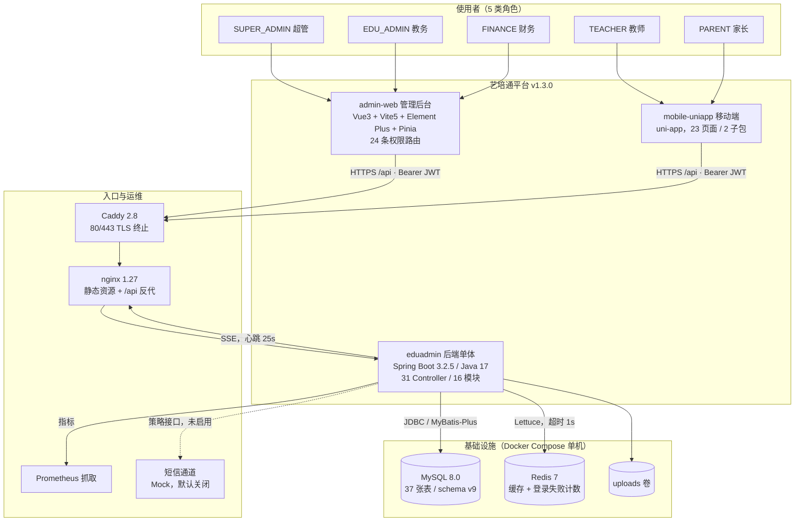
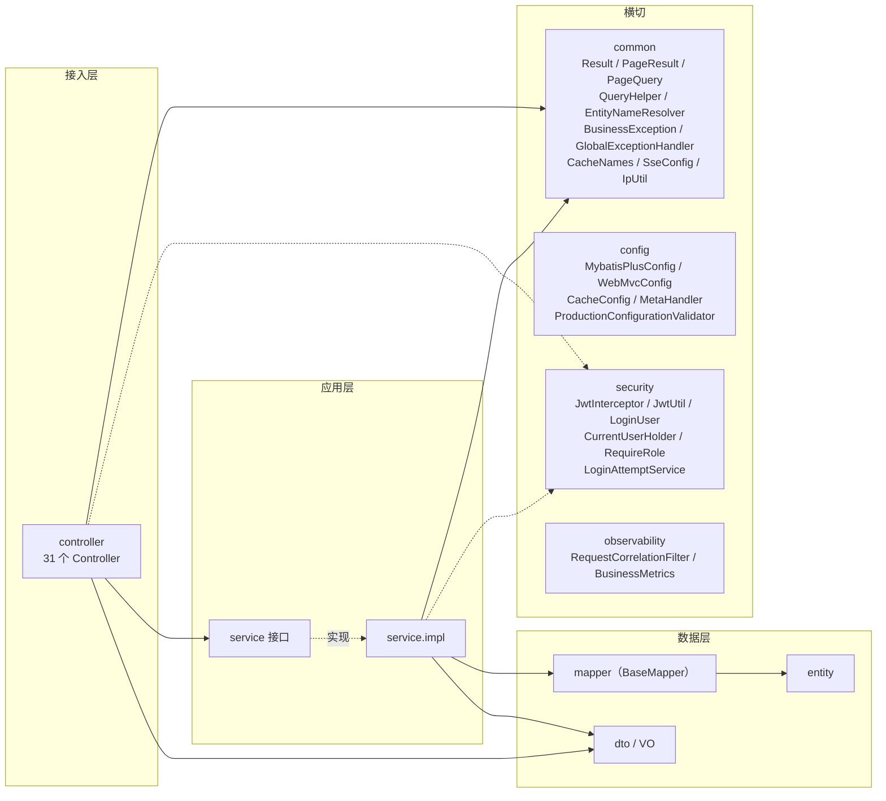
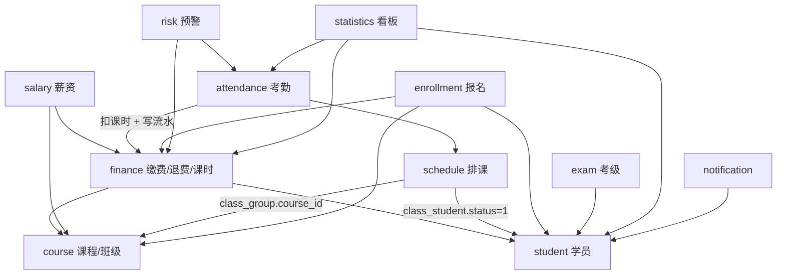
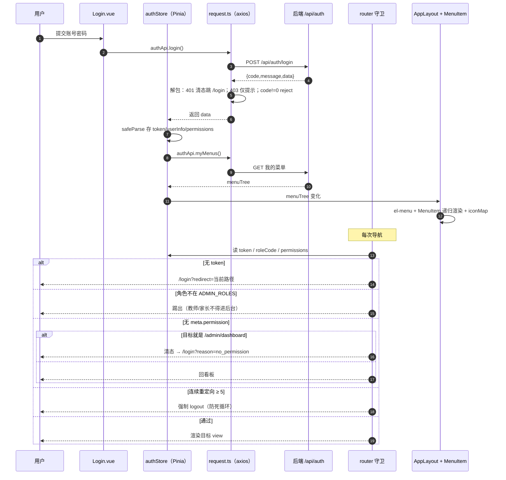
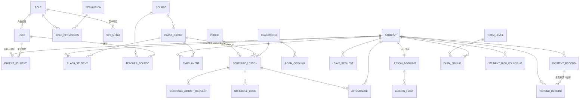
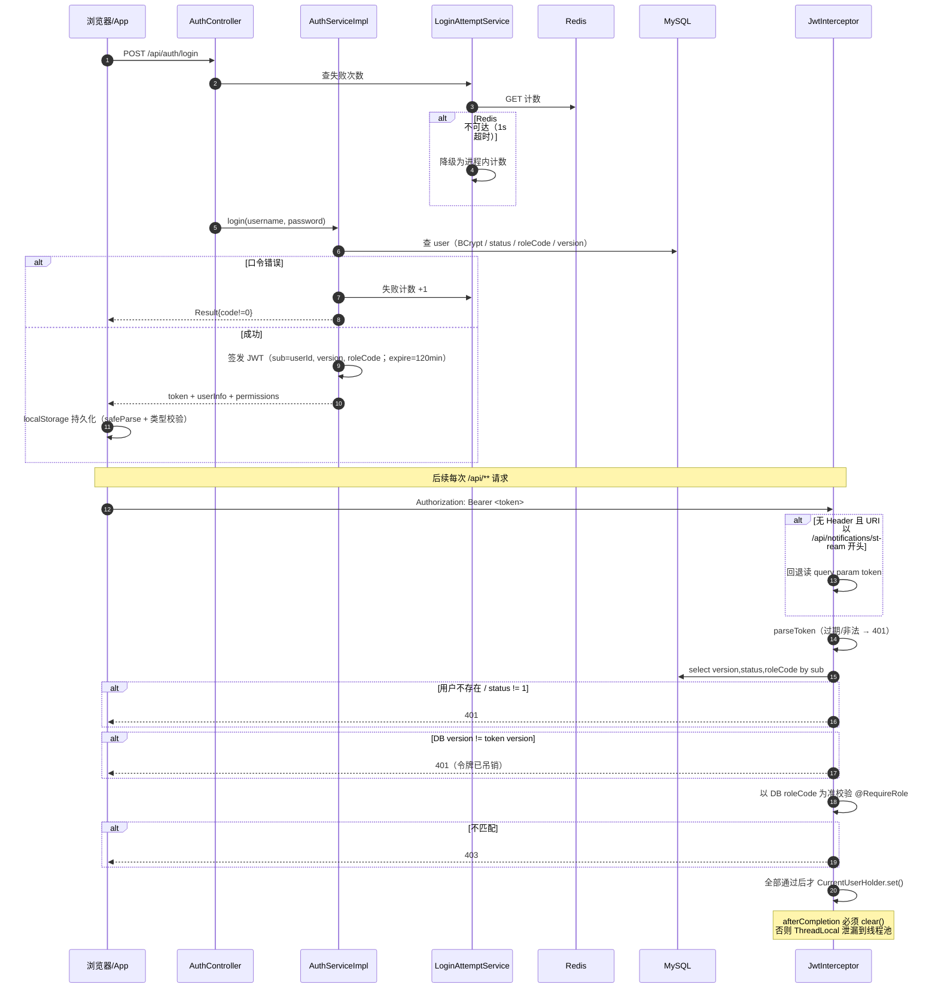
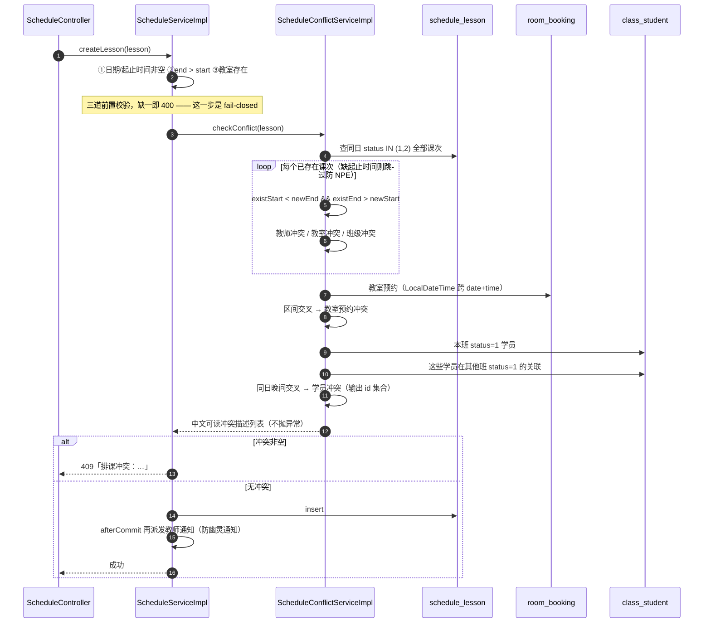
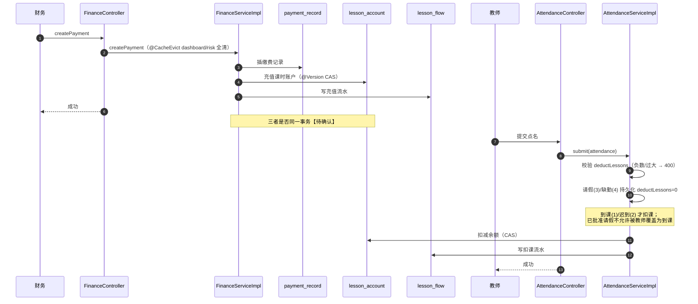
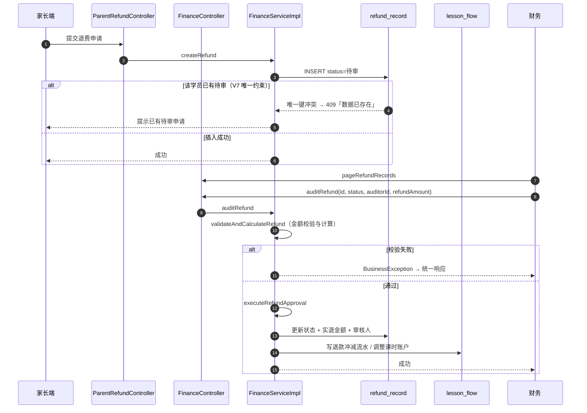
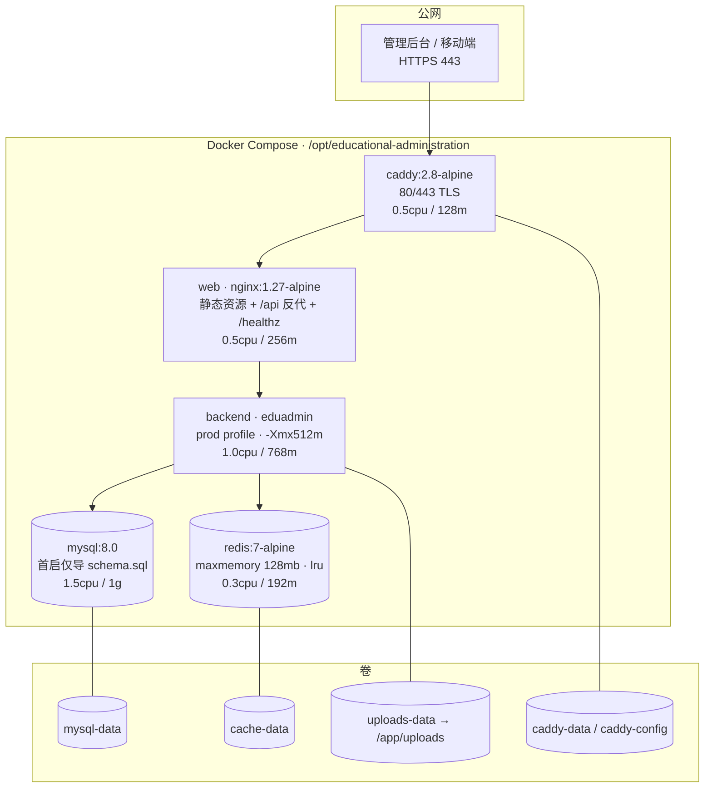

# 艺培通（EduAdmin）现状架构说明书（as-is）

> **基线**：分支 `dev/iteration-next`，HEAD `344f6a6`（2026-10-13）→ **2026-11-20 教师管理改造后** → **2026-11-25 需求补登与课时调整/家长绑定补齐**，三端统一版本 `1.3.0`，数据库 schema 版本 `11`（Flyway 基线 V5 + V6~V11）。
> **产出方式**：主理人齐活林（交付总监）编排，架构师高见远基于证据包做架构推理，主理人逐条回查代码后定稿。
> **核对说明**：本文正文结论均经主理人回查源码确认；凡标注【待确认】者，为静态阅读无法定论、需运行期验证的项。全程未运行任何测试、构建或部署命令。
> **口径**：表 37 张、Controller 31 个、管理端路由 25 条（子路由 24 + `/login`）、移动端页面 23 个、后端 Java 源文件 225 个、测试文件 45 个。

---

## 1. 架构总览

### 1.1 一句话定位

面向**单体艺术培训机构**的「教务（排课 / 考勤 / 考级）+ 财务（缴费 / 退费 / 课时 / 薪资）+ 家校（家长端 / 教师端）」一体化管理系统，采用 **Spring Boot 3 模块化单体后端 + Vue3 管理后台 + uni-app 移动端** 的三端架构，单一 MySQL 实例、单可部署单元。

### 1.2 架构风格判定

| 维度 | 结论 | 依据 |
|---|---|---|
| 部署形态 | **单体**：`finalName=eduadmin`，一个 Spring Boot 进程承载 31 个 Controller | `backend/pom.xml:139` |
| 代码组织 | **模块化单体**：`modules` 下 16 个业务包，包内 controller / service / mapper / entity / dto 分层；横切能力独立为 common / config / security / observability 四包 | `backend/src/main/java/com/pzhu/eduadmin/` |
| 模块边界强度 | **弱边界**：模块间为同进程 Java 调用 + 共享单库 join，无模块级 API 门面约束 | 仅 package 划分，无 facade 约定 |
| 分层模式 | **贫血分层（Package-by-Feature）**：Controller → Service 接口 → ServiceImpl → Mapper → Entity/DTO，非 DDD 聚合根 | `FinanceServiceImpl` 方法签名实测 |
| 前端形态 | 两个独立工程：管理后台 SPA（History 路由）+ uni-app（主包 + 2 子包） | `admin-web/src/router/index.ts`、`mobile-uniapp/src/pages.json` |
| 鉴权模型 | **有状态可吊销的自定义 JWT**（非 Spring Security 过滤器链；Token 带 version，与 DB 比对实现即时吊销） | `security/JwtInterceptor.java` |

**风格小结**：不是微服务，也不是严格 DDD，而是「按业务特性分包 + 弱边界的模块化单体」。横切关注点（鉴权、缓存、可观测、异常）已抽取成独立基础设施包——这是最该在答辩时强调的架构取舍：**用一个进程换取部署与事务的简单性，同时把可复用的工程能力沉淀到横切层**。

### 1.3 C4 上下文

**两个必须讲清的边界**
1. 外网唯一入口是 Caddy；nginx 同时承担静态站点与 `/api` 反代，`proxy_read_timeout=300s` 专为 SSE 拉长。
2. **系统不接任何第三方业务 SaaS**——无支付网关、无真实短信通道（`mock-sms.enabled=false`）。缴费/退费是「记账式」而非在线支付，这是功能边界，答辩时要主动说明。

---

## 2. 技术栈清单

| 层次 | 技术 | 版本 | 作用 |
|---|---|---|---|
| 语言 | Java | 17 | 后端基线 |
| 框架 | spring-boot-starter-parent | 3.2.5 | 版本仲裁 |
| Web | starter-web / starter-validation | 随 parent | REST + SSE / DTO 校验 |
| ORM | mybatis-plus-boot-starter | 3.5.7 | 单表 CRUD、逻辑删除、分页 |
| ORM 补丁 | mybatis-spring | **3.0.4（显式升级）** | 修 SB 3.2.x `factoryBeanObjectType` 兼容问题 |
| 迁移 | flyway-core + flyway-mysql | 随 parent | 生产 schema 版本化（基线 V5） |
| 数据库 | MySQL / mysql-connector-j | 8.0 / runtime | 37 张表 |
| 缓存 | starter-data-redis / Redis 7-alpine | 随 parent | `cache.type=redis`，全局 TTL 60s，`maxmemory 96mb` + `allkeys-lru`，关闭持久化；2026-11-25 实测 `riskSummary` / `riskWarnings` 正常写入并命中（TTL 60→54），登录失败计数同落 Redis |
| 安全 | spring-security-crypto | 随 parent | **仅 BCrypt，不引入过滤器链** |
| 令牌 | jjwt-api / impl / jackson | 0.11.5 | JWT 签发与解析 |
| 观测 | starter-actuator + micrometer-registry-prometheus | 随 parent | 探针 + 指标 |
| 日志 | logstash-logback-encoder | 7.4 | 结构化 JSON |
| 导出 | poi-ooxml | 5.2.5 | Excel |
| 样板 | lombok | 随 parent（打包排除） | getter/setter |
| 测试 | h2 + starter-test | test | 单测 / 集成 |
| 管理端 | Vue 3 + Vite 5 + Element Plus + Pinia + TS | 小版本【待确认】 | PC 后台 |
| 移动端 | uni-app | 小版本【待确认】 | 家长/教师端 |
| 网关 | Caddy 2.8-alpine / nginx 1.27-alpine | — | 入口与反代 |
| 编排 | Docker Compose | 版本【待确认】 | 5 服务单机 |

---

## 3. 后端分层与依赖规则

### 3.1 分层与依赖方向

**实际生效的约定**
1. Controller 只做参数绑定与调用，统一返回 `Result<T>` / `PageResult<T>`。
2. Service **接口 + Impl 双写**，具备依赖倒置能力。
3. 列表的「补名称、关键字过滤」在 Service 层完成（`populatePaymentNames`、`applyNameKeyword`），Controller 保持瘦。
4. 实体审计字段由 `MetaHandler` 自动填充；分页、乐观锁、防全表更新由 `MybatisPlusConfig` 统一装插件。
5. 鉴权不进业务代码——`@RequireRole` 注解 + 拦截器完成。

`MybatisPlusConfig` 实际装了三个插件：`PaginationInnerInterceptor(MYSQL)`、`OptimisticLockerInnerInterceptor`（配合 `@Version` 做 CAS）、`BlockAttackInnerInterceptor`（拦截无 WHERE 的 update/delete）。

### 3.2 已确认的越层与依赖环

| # | 现象 | 性质 | 影响 | 证据 |
|---|---|---|---|---|
| D1 | `JwtInterceptor` 在 `preHandle` 直接查库（`select version,status,roleCode`），绕过 Service | 横切层穿透数据层 | 每请求一次 DB 查询且**无缓存**；DB 抖动直接放大为全站 5xx | `JwtInterceptor.java:70-73` |
| D2 | `EntityNameResolver`（common 包）**直接注入** `StudentMapper` / `UserMapper` / `CourseMapper` / `ClassGroupMapper` | **common 反向依赖各业务模块**，包依赖图出现环 | 新增需要解析名称的模块时，必须回头改 common 包 | `common/EntityNameResolver.java:3-6, 25-28` |
| D3 | 名称回填、关键字模糊过滤下沉到 `FinanceServiceImpl` | 展示层关注点沉入应用层 | Impl 膨胀，单测粒度粗 | `FinanceServiceImpl` 16 个方法 |
| D4 | `StatisticsController`（`/api/admin`）与 `TeacherStatisticsController`（`/api/teacher`）分属不同模块却共享统计口径 | 同一业务双实现 | 管理端与教师端口径可能漂移 | 两个 Controller 并存 |

> D2 已被主理人核实为**真实存在**，不是待确认项：`EntityNameResolver` 通过 Mapper 的 `selectNamesByIdsIncludeDeleted` 绕过 `@TableLogic`，是「历史名称不丢失」的实现手段，代价是 common 包反向依赖。

---

## 4. 业务模块地图（16 模块 × 31 Controller）

| 模块 | 职责 | 对外 URL 前缀 | 主要实体 |
|---|---|---|---|
| `auth` | 登录、注册、当前用户、菜单下发 | `/api/auth`（login/register 免鉴权） | user、sys_menu、role_permission |
| `user` | 账号 / 角色 / 权限 / 菜单 / 组织 | `/api/admin/users`、`/roles`、`/permissions`、`/menus` | user、role、permission、sys_menu、organization |
| `student` | 学员档案、家长绑定 | `/api/edu/students` | student、parent_student、class_student |
| `course` | 课程、班级、教室、任课关系 | `/api/edu`（CourseController） | course、class_group、classroom、teacher_course |
| `enrollment` | 报名、入班、报名历史、家长快照 | `/api/edu/enrollments`、`/api/parent` | enrollment、class_student |
| `schedule` | 学期、课次、排课、调课审核、锁课、教室预约 | `/api/edu`（ScheduleController、PeriodController） | period、schedule_lesson、schedule_adjust_request、schedule_lock、room_booking |
| `attendance` | 点名、请假审批 | `/api/edu`、`/api/teacher`、`/api/parent` | attendance、leave_request |
| `exam` | 考级等级与报名 | `/api/edu/exams` | exam_level、exam_signup |
| `finance` | 缴费、退费、课时账户、课时流水 | `/api/finance`、`/api/export`、`/api/parent` | payment_record、refund_record、lesson_account、lesson_flow |
| `salary` | 薪资规则、教师薪资、调整 | `/api/finance/salaries` | salary_rule、teacher_salary、salary_adjustment |
| `learning` | 作业、学习记录 | `/api`（类级无前缀，方法级全路径） | homework、learning_record |
| `notice` | 公告 | **`/api/admin/notices`（管理）+ `/api/notices`（读取）** | notice |
| `notification` | 站内通知、多渠道分发、SSE | `/api`（含 `/api/notifications/stream`） | notification |
| `risk` | 流失风险评分、预警、跟进 | `/api/admin/risk-warnings` | student_risk_followup |
| `statistics` | 经营看板 | `/api/admin` | statistics_snapshot、operation_log、organization |
| `file` | 上传与受保护下载 | **`/api/files/upload`、`/api/files/{fileName}`** | 无独立表（落 uploads 卷） |

> URL 空间的重要事实：**`/api/parent` 被 4 个 Controller 共用**（Parent / ParentAttendance / ParentLeaveRequest / ParentRefund），**`/api/edu` 被 5 个共用**（AdminAttendance / AdminLeaveRequest / Schedule / Period / Course），**`/api/teacher` 被 4 个共用**（TeacherAttendance / TeacherStatistics / TeacherSalary / TeacherParentContact）。`NoticeController`、`FileController`、`LearningController`、`NotificationController` 无类级前缀，全靠方法级写绝对路径。

### 4.1 模块依赖（按证据可推）

> 除 finance 的名称回填（已核实为 Service 内 Mapper 调用）外，其余箭头表示**数据依赖方向**，具体是 Service 注入还是 Mapper 直查跨模块表，标【待确认】。

---

## 5. 前端架构（admin-web）

### 5.1 分层

| 层 | 内容 | 说明 |
|---|---|---|
| `api` | `request.ts`、`auth.ts`、`edu.ts`、`finance.ts`、`notification.ts` | axios 实例 + 按域拆分的接口函数 |
| `stores` | `auth.ts`、`notification.ts` | Pinia；token / userInfo / permissions 持久化 localStorage |
| `router` | `index.ts` | `createWebHistory`，24 条子路由，`meta.title` + `meta.permission` |
| `views` | 31 个 `.vue` = **25 个页面 + 6 个页面内组件** | dashboard 1 / admin 6 / edu 11 + 5 组件 / finance 5 / auth 1 |
| `components` | 9 个通用组件 + `App.vue` | AppLayout、MenuItem、DataTable、FormDialog、ChartPanel、ExportButton、NotificationBell、ScheduleCalendar、UploadFile |
| `utils` | `error.ts`、`error-guard.ts`、`date.ts`、`protectedFile.ts` | 横切工具 |
| `types` | `types/index.ts` | 前端类型契约 |

### 5.2 权限驱动的「菜单 + 路由」双链路

**关键落差（必须在答辩时能解释）**
- 菜单侧由后端 `myMenus()` 的 `menuTree` 决定可见性（`sys_menu` + `role_permission` 驱动）；
- 路由侧由前端 `meta.permission`（`menu:xxx`）+ `ADMIN_ROLES` 白名单拦截；
- 但**服务端强制只到角色级**（`@RequireRole` 校验 roleCode），前端权限码与后端校验是两套模型——**前端隐藏 ≠ 后端拒绝**。

### 5.3 页面清单

| 分组 | 数量 | 页面 |
|---|---|---|
| dashboard | 1（+1 组件） | `Dashboard.vue` + `components/RiskWarningPanel.vue` |
| admin | 6 | UserList、RoleList、MenuManagement、Organization、OperationLogs、NoticeList |
| edu | 11（+5 组件） | StudentList、CourseList、ClassList、EnrollmentList、ScheduleList、BigSchedule、AdjustAudit、ClassroomList、AttendanceList、ExamList、TeacherList；组件：WeeklyTable、WeeklyCalendar、MonthlyCalendar、EditableWeekGrid、DailyTimeline（+ `useScheduleDrag.ts`） |
| finance | 5 | SalaryList、PaymentList、RefundList、LessonAccountList、LessonFlowList |
| auth | 1 | ChangePassword.vue（强制改密落地页，**无 `meta.permission`**，任何登录用户可达） |
| login | 1 | Login.vue |
| **路由合计** | **24 条子路由** | 挂 `/` → AppLayout，默认重定向 `/admin/dashboard` |

**权限码清单**（共 **27** 条，与 `sql/data.sql` 一致）：`menu:dashboard`、`menu:user`、`menu:role`、`menu:menu`、`menu:organization`、`menu:log`、`menu:notice`、`menu:student`、`menu:course`、`menu:class`、`menu:enrollment`、`menu:big-schedule`、`menu:schedule`、`menu:adjust`、`menu:classroom`、`menu:attendance`、`menu:exam`、`menu:payment`、`menu:refund`、`menu:lesson-flow`（课时流水）、`menu:lesson-account`（课时账户，V12 从 lesson-flow 拆出）、`menu:salary`、`menu:revenue`、`menu:permission`、`menu:teacher`、`menu:system`（系统管理目录，V12 从 user 拆出）、`menu:edu`（教务管理目录，V12 从 student 拆出）。

> 说明：本清单此前只列 21 条，漏了 `menu:revenue`、`menu:permission`（改造前即存在），本次一并补齐并新增 `menu:teacher`。

### 5.4 组件复用策略

| 层次 | 组件 | 复用方式 |
|---|---|---|
| 页面骨架 | `AppLayout` + `MenuItem` | 单布局 + 递归菜单树；折叠态子菜单 teleport 到 body，由 `.sidebar-popper` 接管 |
| CRUD 骨架 | `DataTable` / `FormDialog` | 23 个 CRUD 页面共享 |
| 可视化 | `ChartPanel` | 看板图表统一容器 |
| 导出 | `ExportButton` | 对接 `/api/export` |
| 上传 | `UploadFile` | 对接 file 模块 |
| 实时 | `NotificationBell` | 消费 SSE + notification store |
| 排课交互 | `ScheduleCalendar` + edu/components 6 件 | **组合式函数抽拖拽逻辑（`useScheduleDrag`）+ 多视图渲染分离**，前端最重的一块自研交互 |

---

## 6. 移动端架构（mobile-uniapp）

### 6.1 分包策略

| 分包 | 页面数 | 页面 | 动机 |
|---|---|---|---|
| 主包 | 6 | login、register、home、schedule、messages、auth/change-password | tabBar 三入口 + 登录注册 + 强制改密落地页，首屏必载 |
| `parent` | 9 | enrollment、enrollment-history、payments、schedule、learning、lesson-account、leave-request、refund、notices | 家长专属按需加载 |
| `teacher` | 8 | schedule、attendance、attendance-records、learning、statistics、salary、adjust-request、leave-audit | 教师专属按需加载 |
| **合计** | **23** | | |

- `globalStyle`：背景 `#FAF8F5`、主色 `#0E7490`；`easycom` autoscan 自动注册组件。
- 图标**不依赖 `uni-icons`**，由 `styles/icons.css` 用 SVG data-URI 提供 21 类，离线可用。
- `components/StudentSwitcher.vue` 承担**多子女切换**，是家长端所有页面的上下文前置组件（`getCurrentStudentId` / `setCurrentStudentId` 持久化到 storage）。
- `utils/request.js` 处理了三个真实坑：①`uni.request` 以 Promise 调用时 4xx **仍 resolve**，401 必须在 `.then` 里判而不能放 `.catch`；②并发 401 用 `isRedirectingToLogin` 去重，避免多次 `reLaunch`；③**只有 401 对应的 token 与当前 storage 一致时才清会话**，防止旧请求迟到把新会话清掉。
- 小程序 / App 端 `BASE_URL` 为占位符 `__MP_BASE_URL__`，H5 留空走 Vite 代理——小程序需备案 HTTPS 域名，明确不在本次交付范围。

### 6.2 页面 × 后端入口

| 移动端页面 | 角色 | 后端入口 |
|---|---|---|
| parent/enrollment、enrollment-history | 家长 | `/api/parent`（ParentEnrollmentSnapshotVO） |
| parent/payments、lesson-account、refund | 家长 | `/api/finance`（getPaymentsByStudentIds / getFlowsByStudentId / getByStudentId）+ `/api/parent`（ParentRefundController） |
| parent/schedule、leave-request | 家长 | `/api/parent`（ParentAttendanceController / ParentLeaveRequestController） |
| parent/learning、notices | 家长 | `/api`（LearningController）+ `/api/notices` |
| teacher/attendance、attendance-records | 教师 | `/api/teacher`（TeacherAttendanceController） |
| teacher/schedule、adjust-request、leave-audit | 教师 | `/api/edu`（ScheduleController / AdminLeaveRequestController）【待确认】 |
| teacher/statistics | 教师 | `/api/teacher`（TeacherStatisticsController） |
| teacher/learning | 教师 | `/api`（LearningController） |
| messages（双角色） | 家长 + 教师 | `/api/notifications/*` + `/api/notifications/stream`（SSE，token 走 query） |

**观察**：移动端没有独立网关，直接消费与后台**同一套** `/api/**`，靠 `@RequireRole` 区分能力。因此「同一业务多 URL 入口」（考勤有 `/api/edu`、`/api/teacher`、`/api/parent` 三处）在移动端被放大为三份前端调用逻辑。

---

## 7. 数据架构（37 张表）

### 7.1 分域

| 域 | 表 | 数 |
|---|---|---|
| 权限与组织 | user、role、permission、sys_menu、role_permission、organization | 6 |
| 学员 | student、parent_student、class_student | 3 |
| 教学 | course、class_group、teacher_course、enrollment、homework、learning_record | 6 |
| 排课 | classroom、room_booking、period、schedule_lesson、schedule_adjust_request、schedule_lock | 6 |
| 考勤 | attendance、leave_request | 2 |
| 财务 | lesson_account、lesson_flow、payment_record、refund_record | 4 |
| 薪资 | salary_rule、teacher_salary、salary_adjustment | 3 |
| 考级 | exam_level、exam_signup | 2 |
| 内容与运维 | notice、notification、statistics_snapshot、operation_log、student_risk_followup | 5 |
| **合计** | | **37** |

### 7.2 核心 ER（主干）

### 7.3 关键约束与范式取舍

| # | 约束 / 取舍 | 现状 | 收益 | 代价 |
|---|---|---|---|---|
| C1 | **同一学员只能有一笔待审退费** | **V7 在 DB 层唯一约束强制**，非应用层 `select count` | 并发下也不会双退费，资金安全兜底在 DB | 第二笔只能报约束冲突，需前端友好提示 |
| C2 | **`class_student.status=1` 是「在读」唯一事实源** | 排课冲突检测、教务统计、课时判定都从该表取 | 口径统一 | 退班须改 status；历史课次不存快照 |
| C3 | **`schedule_lesson` 只存 `class_id`，不冗余 `course_id`** | 课程信息经 `class_group.course_id` 二级关联 | 课程改名/换课不产生漂移，写路径最短 | 按课程维度查询全部 2 跳 join，靠 V6/V9/V10/V11 补索引 |
| C4 | **全局逻辑删除 `isDeleted`（0/1）** | MyBatis-Plus `logic-delete-field` 统一生效 | 误删可恢复 | 历史单据名称会被过滤，必须 `loadXxxIncludeDeleted` 绕过 |
| C5 | **`role_permission` / `teacher_course` 为纯关联表** | 按主键物理删除（不做逻辑删除） | 「先清后建」不会撞逻辑删除键 | 关联表无业务属性（如任课有效期）可扩展 |
| C6 | **schema 双轨** | 本地/演示 `sql/schema.sql`（`flyway.enabled=false`）；生产 Flyway（基线 V5 + V6~V11） | 演示部署简单、生产可版本化 | **新表必须同时改两处**，否则漂移 |
| C7 | **并发控制** | `lesson_account` 上有 `@Version` + `OptimisticLockerInnerInterceptor`（**已核实**）；`refund_record` 有 DB 唯一约束；`user.version` 用于令牌吊销（非乐观锁） | 课时余额 CAS 更新，冲突转为业务异常 | 达上限需重试或提示 |

> C7 的澄清：`@Version` 只出现在 `finance/entity/LessonAccount.java:29`，配合 `BusinessMetrics` 的 `eduadmin.lesson_account.cas_failures`（reason=conflict）指标，说明**课时扣减走 CAS 并在冲突时打点**。其余实体未发现 `@Version`。

---

## 8. 关键流程时序

### 8.1 登录与 Token 吊销

**设计要点**
1. **无状态 JWT + 有状态校验的混合**：Token 无状态，但每请求用 DB `version` 比对，实现「改密/禁用/角色变更即刻生效」，补上纯 JWT 无法吊销的缺口。
2. **权限取 DB 而非 Token**：角色变更无需重登，代价是每请求一次 DB 查询（无缓存，见 P1-2）。
3. **ThreadLocal 时序正确**：`set` 放在全部校验之后，`afterCompletion` 清理——这是全系统最值得讲的一处细节，注释里明确分析了「提前 set 会导致校验失败分支不执行 afterCompletion」。

### 8.2 排课冲突检测（5 维）

**设计要点**
1. 区间判定全系统统一为 `existStart.isBefore(newEnd) && existEnd.isAfter(newStart)`，不存在半开/闭区间混用。
2. **第 5 维「学员跨班冲突」是业务亮点**：多数同类系统只查教师/教室，这里通过 `class_student` 双向查询识别「同一学员被两个班同时排课」。
3. **fail-closed 的真正位置在 Service 入口**：`createLesson` 对日期/起止时间/教室存在性做三道前置校验后才调冲突检测；`updateLesson` 还会先合并非 null 字段，确保部分更新时检测用的是完整数据。`checkConflict` 内部的「关键字段缺失即返回空列表」只是防御性早退，**不是**主写路径的漏洞。真正遗留的是**并发双写**（见 P1-1）。

### 8.3 缴费 → 课时账户 → 考勤扣课 → 流水

**设计要点**
1. **「余额表 + 流水表」双写**：`lesson_account` 存当前余额（读快），`lesson_flow` 存不可变流水（可审计、可重放校验）。
2. **请假/缺勤的 `deductLessons` 必须落 0**，否则报表会出现「请假却扣了 1 课时」，且未来冲销若漏判状态会多退课时——注释里写明了这个后果。
3. 历史名称通过 `loadStudentNamesIncludeDeleted` / `loadCourseNamesIncludeDeleted` **绕过逻辑删除**，保证已删学员/课程的历史流水仍显示原名（财务账本不可变意识）。

### 8.4 退费申请 → 审核 → 入账

**设计要点**
1. **三段式职责分离**：申请（家长）→ 审核（财务，`validateAndCalculateRefund`）→ 执行入账（`executeRefundApproval`），每环节状态可追溯。
2. **V7 把资金安全下限放在 DB**，而不是应用层 `select count`（后者并发下失效）。
3. 审核入参含 `refundAmount`，**实退金额可被审核人调整**，与申请金额解耦——需要 `operation_log` 审计配合。

---

## 9. 横切关注点

| 关注点 | 现状 | 约束 / 代价 |
|---|---|---|
| **鉴权** | 自定义 `JwtInterceptor` 挂 `/api/**`，排除 `login`/`register`；`spring-security-crypto` 仅用 BCrypt，不引过滤器链 | 排除路径是**硬编码白名单**，新增免鉴权接口必须改代码；无 `@PreAuthorize` 体系 |
| **授权** | `@RequireRole` 支持类级/方法级，按 **roleCode** 校验（DB 为准） | 粒度只到「角色」；`permission`/`role_permission` 只支撑前端菜单可见性。**接口级权限点校验证据未见** |
| **令牌吊销** | `user.version` 与 Token 内 version 比对 | 每请求一次 DB 查询（无缓存）；改密/踢人即生效 |
| **SSE 鉴权特例** | `/api/notifications/stream` 无 Header 时读 `?token=` | Token 可能落入 nginx access log / 浏览器历史 / Referer |
| **CORS** | `allowCredentials=true`，`allowedOriginPatterns` 取 `app.cors.allowed-origins`，默认 `http://localhost:*,http://127.0.0.1:*` | 通配 localhost + 携带凭证是开发配置；生产由 `APP_CORS_ALLOWED_ORIGINS` 覆盖 |
| **缓存** | `spring.cache.type=redis`，**全局 TTL 60s**；`CacheNames` 三个域：`dashboard`（看板）、`riskWarnings`、`riskSummary` | 全局统一 TTL，字典类数据也被 60s 击穿 |
| **缓存主动失效** | `@CacheEvict(allEntries=true)` 实测出现在 **6 个模块 18 处**：Finance 3、Course 3、Enrollment 4、Schedule 4、Student 3、Risk 1 | **attendance / salary / exam / notice 未见 @CacheEvict**：考勤扣课后看板最长 60s 内可能不刷新（有 TTL 兜底，非致命） |
| **缓存降级** | `CacheConfig` 实现 `CachingConfigurer`，get/put/evict/clear 四类异常**只 warn 忽略** | 缓存是「可丢失加速层」，不改变业务返回值、不使写操作失败 |
| **缓存超时** | `spring.data.redis` connect-timeout / timeout 均 **1s** | 显式规避 Lettuce 默认 60s：Redis 不可达时会把接口从毫秒拖到分钟 |
| **登录限流降级** | `LoginAttemptService` Redis 不可用时降级进程内计数 | 单实例有效；水平扩容即失效 |
| **可观测-日志** | `RequestCorrelationFilter`（`@Order(HIGHEST_PRECEDENCE)`）注入 `X-Request-Id` 到 MDC，正则白名单 `[A-Za-z0-9._-]{8,128}` 防注入，响应头回写；`logstash-logback-encoder` 输出 JSON | 关联 ID 是否透传到 SSE 异步线程【待确认】 |
| **可观测-指标** | `BusinessMetrics` 预注册 6 组 counter（login / enrollment / payment / lesson_account.cas / schedule.conflicts / notification.failures）+ `eduadmin.refunds.pending` Gauge，Gauge 异常返回 `NaN` 而非抛错 | 采集端 Prometheus 不在 compose 内，需外部抓 |
| **可观测-探针** | readiness = `readinessState,db`；liveness = `livenessState` | 语义正确：DB 挂摘流量，不因 DB 抖动被重启 |
| **统一响应** | `Result{code,message,data}`；`GlobalExceptionHandler` 覆盖 400/404/405/409/415/500 与 `HandlerMethodValidationException` | 前端 401 用 `window.location` 硬跳，破坏 SPA 状态 |
| **异常语义** | 业务异常走 `BusinessException`；**排课冲突不抛异常**返回字符串列表 | 两类语义混用，调用方无法程序化区分 |
| **逻辑删除** | `logic-delete-field=isDeleted`（1/0）；关联表用 `@Delete` 物理删除 | 历史单据名称需绕过逻辑删除 |
| **并发控制** | `lesson_account.@Version` CAS；`refund_record` DB 唯一约束；`BlockAttackInnerInterceptor` 拦无 WHERE 更新 | 其余实体无乐观锁 |
| **数据库迁移** | 默认 `flyway.enabled=false`；prod 启用 `baseline-on-migrate=true` + `baseline-version=5` + `validate-on-migrate=true` + `clean-disabled=true` + `out-of-order=false`，已到 V11 | 双轨 schema，新表须改两处 |
| **生产配置校验** | `ProductionConfigurationValidator`（`@Profile("prod")`）：DB 密码 ≥16 字符且非默认值（黑名单 123456/password/root/edu_admin）；JWT secret ≥32 UTF-8 字节且非默认；CORS 必须精确 origin（含 `*` 即拒绝） | **缺失即启动失败**，这是很硬的一道护栏（已核实，非待确认） |
| **优雅停机** | `server.shutdown=graceful` + `timeout-per-shutdown-phase=30s`；容器 `stop_grace_period=40s` | 40s 覆盖 SSE 心跳 25s 与 30s 生命周期超时，让长连接自然关闭 |

---

## 10. 部署与运行架构

### 10.1 容器拓扑

### 10.2 服务职责

| 服务 | 镜像 | 端口 | 资源上限 | 关键配置 | 依赖 |
|---|---|---|---|---|---|
| `caddy` | caddy:2.8-alpine | 80/443 | 0.5 / 128m | 挂 `Caddyfile` | `web` |
| `web` | `${WEB_IMAGE}`（nginx 1.27） | 内部 | 0.5 / 256m | `/healthz` → 后端 readiness；`stop_grace_period=40s`；`proxy_read_timeout=300s` | `backend` |
| `backend` | `${BACKEND_IMAGE}` | 8080 内部 | 1.0 / 768m | prod profile、`-Xmx512m`、挂 `uploads` | `mysql: healthy`、`cache: started` |
| `mysql` | mysql:8.0 | 内部 | 1.5 / 1g | 首启**只导 `schema.sql`**，明确不导 `data.sql`（22 账号弱口令 123456） | `mysqladmin ping` |
| `cache` | redis:7-alpine | 内部 | 0.3 / 192m | `--maxmemory 128mb --maxmemory-policy allkeys-lru` | 无强依赖 |
| 日志 | — | — | — | 全服务 json-file `10m × 3` | — |

### 10.3 健康检查与停机设计意图

| 设计 | 意图 |
|---|---|
| `web` 探 `/healthz` → 反代后端 readiness | 前端容器健康不取决于自身静态文件，而取决于**下游后端是否就绪**（readiness 含 db），端到端判定 |
| `backend` 用 `bash /dev/tcp` 手写 HTTP GET readiness 并 grep `UP` | 运行镜像无 curl/wget 也能自探活，不把探测建立在未验证的假设上 |
| `cache: service_started`（**不是** `service_healthy`） | 缓存是可丢失加速层，只约束启动顺序，避免 Redis 故障拖垮后端启动 |
| 双端 `stop_grace_period=40s` + graceful + 30s 生命周期 | 对应 SSE 心跳 25s、`proxy_read_timeout=300s`，发版时不让长连接被硬切 |
| MySQL 首启只导 `schema.sql` | 演示弱口令数据与生产物理隔离，安全红线 |

### 10.4 发布 / 回滚 / 备份

| 环节 | 脚本 | 现状 |
|---|---|---|
| 发布 | `release-production.sh` | 镜像 tag 化发布 |
| 回滚 | `rollback-images.sh` | 按镜像回滚（非 DB 回滚） |
| 备份 | `backup-common.sh`、`backup-production.sh`、`run-scheduled-backup.sh` | 定时备份脚本化 |
| 恢复演练 | `restore-drill.sh`、`restore-production.sh` | **有独立恢复演练脚本**，运维成熟度证据 |
| 门禁 | `critical-journey-ci.sh`、`test-acceptance-python-runtime.sh` | 关键路径 CI 脚本 |
| 文档 | `RELEASE_RUNBOOK.md`、`BACKUP_AND_RESTORE.md`、`OBSERVABILITY.md`、`deploy/README.md` | 齐备 |
| 线上 | 腾讯云 `101.35.239.218` / Compose 在 `/opt/educational-administration` | 单机 |
| 镜像 | web / backend 均为 `v1.3.0-20261125` | **已同批发布**（2026-11-25，含课时人工调整与家长自助绑定、Flyway V11）；此前"构建日期差一个月"的 P1-4 已闭环 |

---

## 11. 架构评估

### 11.1 ✅ 做得好（答辩亮点）

| # | 亮点 | 出处 |
|---|---|---|
| H1 | **DB 驱动的 JWT 吊销 + 授权取 DB 角色**：Token 带 version 每次比对；角色以 DB `roleCode` 为准，改角色/禁用/改密即刻生效 | `JwtInterceptor.java:69-91` |
| H2 | **ThreadLocal 生命周期正确**：`set` 放在全部校验之后，`afterCompletion` clear，注释显式分析泄漏路径 | `JwtInterceptor.java:102-112` |
| H3 | **缓存的「可丢失加速层」语义落到代码**：四类异常全部 warn 忽略 | `CacheConfig.java:27-52` |
| H4 | **显式规避 Lettuce 默认 60s 超时陷阱**：connect/timeout 均 1s，注释直指「会把接口从毫秒拖到分钟」 | `application.yml:33-37` |
| H5 | **排课冲突 5 维检测**，含「学员跨班冲突」与「教室预约冲突」；区间判定全系统统一 | `ScheduleConflictServiceImpl.java:47-146` |
| H6 | **排课写入口三道前置校验（fail-closed）**：日期/起止时间非空、end>start、教室存在性（防悬空引用） | `ScheduleServiceImpl.java:270-279` |
| H7 | **通知 afterCommit 派发防「幽灵通知」**：事务回滚时不派发，避免「课次不存在但教师已收到通知」 | `ScheduleServiceImpl.java:298-315` |
| H8 | **退费三段式 + V7 DB 唯一约束**：申请/审核/入账分离，资金安全下限放 DB | `FinanceServiceImpl.java:321-500`、V7 |
| H9 | **财务历史数据不可变意识**：`loadXxxIncludeDeleted` 绕过逻辑删除，已删学员/课程的历史流水仍显示原名 | `FinanceServiceImpl.java:661-682` |
| H10 | **课时余额 CAS + 冲突打点**：`LessonAccount.@Version` + `OptimisticLockerInnerInterceptor` + `eduadmin.lesson_account.cas_failures` 指标 | `LessonAccount.java:29`、`BusinessMetrics.java:24` |
| H11 | **Flyway 生产化配置完整**：baseline + validate + clean-disabled + out-of-order=false | `application-prod.yml:4-13` |
| H12 | **生产配置启动期硬校验**：DB 密码 ≥16 且非默认、JWT ≥32 字节、CORS 必须精确 origin | `ProductionConfigurationValidator.java:35-62` |
| H13 | **readiness 含 db / liveness 不含** —— 探针语义正确 | `application-prod.yml:41-45` |
| H14 | **优雅停机与 SSE 时长对齐**：40s ↔ 25s 心跳 + 30s 生命周期 | compose + yml |
| H15 | **缓存不做可用性依赖**：`redis: service_started` 而非 healthy | compose:52-53 |
| H16 | **演示数据仅用于首次建库**：compose 把 `data.sql` 挂到 `/docker-entrypoint-initdb.d/`，MySQL **仅在数据目录为空时**执行；⚠️ 若数据卷被删除重建，会导入 20 个弱口令（123456）演示账号，须人工确认后再启用 | compose:15 |
| H17 | **前端防御式编程**：`safeParse` 同时兜底 JSON 损坏与类型错乱；守卫 `MAX_REDIRECTS=5` 防死循环、看板无权限时清态跳 `?reason=no_permission` 避免静默循环 | `stores/auth.ts:15-39`、`router/index.ts:161-222` |
| H18 | **移动端 request 层处理了三个真实坑**：4xx 仍 resolve、并发 401 去重、只清「本次 token 对应」的会话 | `mobile-uniapp/src/utils/request.js:24-92` |
| H19 | **风险评分因子封顶**（f1=70/f2=30/f3=35/f4=25/f5=10）+ 窗口天数 + 阈值分级，避免单因子支配 | `application.yml:73-88` |
| H20 | **运维成熟度超本科毕设平均线**：恢复演练脚本、关键路径 CI、发布 runbook、可观测性文档；移动端 3 个 utils 带单测 | `deploy/scripts/*` |

### 11.2 ⚠️ 风险与技术债

#### P0（安全红线 / 数据正确性）

| # | 现象 | 影响 | 建议 |
|---|---|---|---|
| P0-1 | **授权粒度只到角色**：后端 `@RequireRole` 按 roleCode；`permission`/`role_permission` 只支撑前端菜单 | 角色内无法细分（如「某教务可看不可导出」）；**前端隐藏 ≠ 后端拒绝**，改成前端直接调接口即可越权 | 新增 `@RequirePermission("finance:refund:audit")`，与前端 `meta.permission` 用**同一套权限码**，后端为最终裁决 |
| P0-2 | **SSE 用 `?token=` 传令牌** | Token 进 access log / 浏览器历史 / Referer，日志泄露即可冒用 2 小时 | 改为主 Token 换取的 30s 一次性 `sseTicket`；至少对 nginx 日志做 `token` 脱敏 |

#### P1（可用性 / 正确性）

| # | 现象 | 影响 | 建议 |
|---|---|---|---|
| P1-1 | **排课「先查后写」无 DB 排他约束**（`checkConflict` 在 Service 内先查再 insert） | 两个并发请求都查到「无冲突」→ **双写成功**，产生冲突课次（单请求路径已有三道前置校验，不存在脏数据绕过） | 复用已有 `schedule_lock` 表，对 `(teacher_id,date,start)` 建唯一索引，或写前 `SELECT ... FOR UPDATE` |
| P1-2 | **URL 空间按调用方角色划分而非资源**：`/api/edu` 5 个 Controller、`/api/parent` 4 个、`/api/teacher` 4 个共用；4 个 Controller 无类级前缀 | 同一业务有 3 个 URL 入口，逻辑与鉴权三处维护；无法从 URL 反推模块，权限点/文档难自动生成 | 收敛为 `/api/attendance`、`/api/leave-requests` 等资源式路径，用角色注解区分调用方；强制类级前缀 |
| P1-3 | **每请求一次 DB 鉴权查询**，无缓存 | 高峰期 QPS 被 DB 连接数硬约束；DB 抖动放大为全站 5xx | `version/status/role` 加 5~10s 本地缓存（Caffeine）+ 变更主动失效 |
| P1-4 | ~~线上镜像与代码不同步~~ **已闭环（2026-11-20）**：双镜像同批发布为 `eduadmin-web:v1.3.0-20261120-m` + `eduadmin-backend:v1.3.0-20261120`，数据库 schema 8→10；2026-11-25 再次同批发布 `v1.3.0-20261125`（双镜像同 tag），schema 10→11 | 原风险（答辩演示行为 ≠ 仓库代码）已消除 | 建议在发布脚本中固化「同一次构建出双镜像 + 同一 tag」，避免后续回退 |
| P1-5 | **后端内存余量偏薄**：容器 768m、`-Xmx512m`，非堆仅 ~256m；系统含 `poi-ooxml` 且提供 Excel 导出 | 大报表并发 2~3 个即可能 Direct buffer OOM / 容器 OOMKilled（表现为 502） | 导出改流式 `SXSSFWorkbook` + 分页写，或走异步任务落 `uploads` 卷 |
| P1-6 | **集成测试仅 4 条链路**（报名缴费、考勤扣课、退费、自动排课），排课/薪资/考级/通知/文件只有单测 | 跨模块事务边界（缴费→账户→流水）未被端到端验证 | 把 `critical-journey-ci.sh` 固化为发布门禁 |

#### P2（体验 / 演进成本）

| # | 现象 | 影响 | 建议 |
|---|---|---|---|
| P2-1 | **考勤/薪资/考级/公告写操作无 `@CacheEvict`** | 考勤扣课后看板最长 60s 不刷新（TTL 兜底，非致命） | 补齐这四处的 `@CacheEvict`，或统一在 Mapper 层做拦截 |
| P2-2 | 前端 401 用 `window.location` 硬跳 | 全页刷新丢 SPA 状态与未提交表单 | 改 router 跳转 |
| P2-3 | 无 Token 刷新机制，`expire-minutes=120` 固定 | 每 2 小时强制重登，家长端体验差 | 引入 refresh token 或滑动续期 |
| P2-4 | `FinanceServiceImpl` 承担名称回填与模糊过滤 | Impl 膨胀（16 方法），单测粒度粗 | 抽 `FinanceAssembler` / `NameFiller` |
| P2-5 | 统计双实现（`StatisticsController` / `TeacherStatisticsController`） | 管理端与教师端口径可能漂移 | 抽统一 `StatisticsQueryService`，Controller 只做角色过滤 |
| P2-6 | `common.EntityNameResolver` 反向依赖 4 个模块 Mapper | 包依赖成环，新增模块要改公共包 | 改「各模块实现 `NameProvider` 接口，common 只定义接口」 |
| P2-7 | 管理端与移动端各有一套 request / error 处理 | 401/403/解包语义两处维护 | 抽共享 TS 包或 OpenAPI 生成客户端 |
| P2-8 | `statistics_snapshot` 表存在，但看板走实时查 + 60s 缓存 | 若闲置则为死表 | 明确取舍：用快照降温，或移除 |

### 11.3 🔭 演进建议（按投入产出排序）

| 序 | 建议 | 投入 | 产出 | 理由 |
|---|---|---|---|---|
| 1 | **统一授权模型：`permission` 码贯通前后端**（P0-1） | 中 | 高 | 表结构已就位，只差后端校验一环，属「补最后一块」 |
| 2 | **排课并发加 DB 兜底**（P1-1） | 低 | 高 | 复用 `schedule_lock`，改动面小，直接消除一类脏数据 |
| 3 | **收敛 URL 空间为资源式 + 强制类级前缀**（P1-2） | 中 | 高 | 越早做成本越低，后续权限点/限流/审计都依赖稳定 URL 空间 |
| 4 | **发布流水线绑定双镜像同 sha**（P1-4） | 低 | 中 | 直接决定答辩演示与仓库是否一致 |
| 5 | **鉴权查询加本地缓存**（P1-3） | 低~中 | 中 | 吞吐提升，且降低 DB 抖动对全站的影响 |

---

## 12. 附录

### 12.1 证据索引

| 编号 | 路径 | 用于 |
|---|---|---|
| 1 | `backend/pom.xml` | 技术栈与版本、内存评估 |
| 2 | `backend/src/main/java/com/pzhu/eduadmin/**`（16 modules + common/config/security/observability） | 分层、模块地图、横切 |
| 3 | 各 Controller 类级 `@RequestMapping`（31 Controller / 29 类级前缀） | 模块地图、URL 空间问题 |
| 4 | `config/WebMvcConfig.java`、`security/JwtInterceptor.java` | 鉴权链路、H1/H2 |
| 5 | `application.yml`、`config/CacheConfig.java`、`security/LoginAttemptService.java` | 缓存与降级、H3/H4 |
| 6 | `application-prod.yml` | 迁移、探针、H11/H12/H13 |
| 7 | `sql/schema.sql`（37 表） | 数据架构、C1~C6 |
| 8 | `db/migration/V6~V11*.sql` | C1、迁移策略 |
| 9 | `schedule/service/ScheduleConflictServiceImpl.java`、`ScheduleServiceImpl.java` | 排课时序、H5/H6/H7 |
| 10 | `finance/service/FinanceServiceImpl.java`、`finance/entity/LessonAccount.java` | 财务流程、H8/H9/H10 |
| 11 | `notification/**`（Channel / Dispatcher / Reminder / SSE） | 通知子系统 |
| 12 | `risk/**`（RiskRuleProperties / RiskScoringEngine / RiskWarningService） | 风险预警、H19 |
| 13 | `admin-web/src/**` | 前端架构、H17 |
| 14 | `mobile-uniapp/**` | 移动端、H18 |
| 15 | `deploy/docker-compose.production.yml`、`deploy/scripts/*`、`deploy/*.md` | 部署架构、H14/H15/H16/H20 |
| 16 | `backend/src/test/java/**`（46 文件，含 4 条集成） | 测试资产、P1-6 |
| 17 | `config/MybatisPlusConfig.java`、`common/EntityNameResolver.java`、`common/GlobalExceptionHandler.java`、`observability/BusinessMetrics.java` | 插件配置、P2-6、异常语义 |

### 12.2 【待确认】清单（需运行期验证，静态阅读无法定论）

1. `createPayment` 的「缴费记录 + 课时账户 + 流水」是否同一事务（`@Transactional` 覆盖范围）。
2. `@CacheEvict` 未覆盖的写路径（考勤/薪资/考级/公告）是否通过其他方式失效缓存。
3. `APP_CORS_ALLOWED_ORIGINS` 缺失时的实际行为（空字符串 → 无 origin 允许，还是回退默认）。
4. `RequestCorrelationFilter` 的 requestId 是否透传到 `@Async` / SSE 线程（MDC 不自动继承）。
5. `statistics_snapshot` 是否被实际读写，还是历史遗留表。
6. 管理端与移动端依赖的具体小版本（`package.json` 未逐项核对）。
7. `statistics` 模块是否直接跨模块 join 表（而非走各自 Service）。
8. 移动端教师端「调课审核」实际调用的后端路径（推断为 `/api/edu`）。

### 12.3 总评

这是一个**横切关注点成熟度显著高于一般本科毕设**的模块化单体：鉴权吊销、缓存降级、优雅停机、探针语义、生产配置硬校验、恢复演练都有明确工程痕迹与成体系注释，且注释多为「踩坑复盘」而非「功能说明」，可信度高。

主要短板集中在四处，均可在小投入内闭环：

1. **授权粒度只到角色**（P0-1）——表结构已就位，只差后端校验；
2. **SSE 令牌走 query**（P0-2）；
3. **URL 空间按角色而非资源划分**（P1-2）；
4. **排课并发缺 DB 兜底**（P1-1）。

建议把「现状 → 问题 → 改进」作为答辩叙事主线：先说清为什么选模块化单体（事务简单、部署便宜、与单体机构规模匹配），再主动指出这四处并给出演进路径——**能自己指出问题并给出方案，比声称没有问题更有说服力**。
